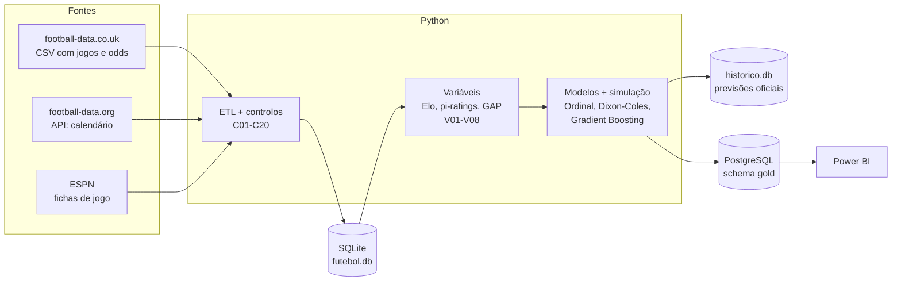

# Previsões da Liga Portugal 2026-27

[](https://github.com/gabz2009/futebol/actions/workflows/testes.yml)


Um pipeline de dados completo, das fontes ao relatório. Recolhe os jogos da Liga Portugal, prevê o resultado de cada jogo (vitória, empate ou derrota), simula o resto da época 10 000 vezes e mostra tudo num relatório em Power BI. Corre sozinho todas as semanas.

## O resultado, sem enfeites

O modelo foi fechado antes da época de teste (2025-26) e depois avaliado nos 306 jogos dessa época, que nunca tinha visto. A referência são as odds das casas de apostas:

| Modelo | Acerto | Log loss | RPS |
| --- | ---: | ---: | ---: |
| Odds de fecho (no dia do jogo) | 57,5% | 0,9011 | 0,1702 |
| Odds de abertura (cerca de uma semana antes) | 56,5% | 0,9110 | 0,1733 |
| **Modelo final** | **55,6%** | **0,9131** | **0,1734** |
| Frequências (casa / empate / fora) | 41,2% | 1,0861 | 0,2297 |

**Resumindo:** o modelo fica ao nível das odds de abertura. A diferença no log loss é de 0,002 e o bootstrap mostra que pode ser sorte, para um lado ou para o outro. Não ganha às casas de apostas, mas também não perde de forma clara. Ninguém mexeu no modelo desde então: as previsões oficiais da época 2026-27 são feitas antes de cada jornada e ficam guardadas em `dados/historico.db`, que está no Git. O histórico de commits prova que foram feitas antes dos jogos.

## Stack

- **Python** (pandas, NumPy, SciPy, scikit-learn) para o ETL, as variáveis e os modelos
- **SQLAlchemy** e **psycopg** para a ligação ao PostgreSQL
- **SQLite** como base de dados de trabalho
- **PostgreSQL** como data warehouse (schema `gold`, em estrela)
- **Power BI** para o relatório (tema Synthwave, DAX e medidas em HTML)
- **pytest** e **GitHub Actions** para os testes
- **Agendador de Tarefas do Windows** para correr tudo uma vez por semana

## Como funciona



1. **Recolha:** descarrega os CSV de jogos, o calendário da época pela API e as fichas de jogo da ESPN (onzes, substituições, estatísticas por jogador).
2. **ETL:** junta e limpa tudo numa base SQLite. Corre 20 controlos de qualidade; se um controlo crítico falhar, o pipeline pára.
3. **Variáveis:** calcula ratings de força de cada equipa (Elo, pi-ratings e GAP ratings) usando só os jogos anteriores a cada jogo, para não haver fuga de informação.
4. **Previsão:** o modelo final é a média de três modelos (Regressão ordinal, Dixon-Coles e Gradient Boosting). A seguir, uma simulação Monte Carlo joga o resto da época 10 000 vezes e dá a probabilidade de cada equipa ser campeã, ir à Europa ou descer.
5. **Warehouse:** carrega 21 tabelas (dimensões e factos) para o PostgreSQL numa única transação. Se o número de linhas não bater certo, nada é gravado.
6. **Relatório:** o Power BI lê o schema `gold`.

Os detalhes dos modelos, da avaliação e das decisões estão em [docs/metodologia.md](docs/metodologia.md).

## O relatório

| Jornada | Classificação |
| --- | --- |
|  |  |
| **Evolução** | **Modelo em tempo real** |
|  |  |
| **Equipa** (drill-through) | **Sobre o projeto** |
|  |  |

O ficheiro `powerbi/futebol.pbit` é o modelo do relatório, sem dados. Ao abrir, o Power BI pede a ligação ao PostgreSQL.

## Como correr

**Requisitos:** Python 3.12 e PostgreSQL. O Power BI Desktop só é preciso para o relatório.

```bash
git clone https://github.com/gabz2009/futebol.git
cd futebol
python -m venv .venv
.venv\Scripts\activate          # Windows (no Linux/macOS: source .venv/bin/activate)
pip install -r requirements.txt
```

Copia o `.env.example` para `.env` e preenche com os teus dados. O `.env` não vai para o GitHub.

```
FOOTBALL_DATA_TOKEN=     # chave gratuita em football-data.org
PG_HOST=
PG_PORTA=
PG_BASE=
PG_UTILIZADOR=
PG_PALAVRA_PASSE=
```

Depois corre tudo por ordem:

```bash
python etl/executar_tudo.py                  # descarrega os dados novos e corre tudo
python etl/executar_tudo.py --sem-internet   # usa só os ficheiros que já tens
```

O `executar_tudo.py` corre os passos por esta ordem e pára logo se um falhar:

| Passo | O que faz |
| --- | --- |
| `descarregar_calendario.py` | calendário e resultados da época pela API |
| `descarregar_jogadores.py` | fichas de jogo da ESPN (só as novas) |
| `descarregar_csv.py` | CSV de jogos e odds |
| `executar_etl.py` | limpeza, junção e controlos C01 a C20 |
| `processar_jogadores.py` | onzes, minutos e estatísticas dos jogadores |
| `criar_variaveis.py` | ratings das equipas e controlos V01 a V08 |
| `prever.py` | previsões, simulação e controlos P, S e H |
| `carregar_warehouse.py` | carga para o PostgreSQL e controlo W01 |

**Agendamento:** o `executar_agendado.bat` corre o pipeline com o Agendador de Tarefas do Windows, todas as terças às 10h, e guarda o resultado em `dados/agendamento.log`. Num ambiente profissional, isto seria feito com um orquestrador como o Airflow. Para um pipeline semanal num só computador, o agendador do sistema chega.

## Testes e qualidade dos dados

- **100 testes** com pytest (`pytest -q`), que correm no GitHub Actions a cada push.
- **Controlos em cada execução**, guardados em tabelas de QA:
  - **C01 a C20:** ficheiros, colunas, jogos repetidos, odds plausíveis, nomes de equipas, calendário completo, golos iguais nas duas fontes.
  - **V01 a V08:** variáveis. Por exemplo, o V04 verifica que alterar um jogo só muda as variáveis dos jogos seguintes (anti-fuga).
  - **P01 a P04, S01 a S02, H01:** previsões, simulação e histórico.
  - **W01:** as linhas carregadas no warehouse são iguais às linhas preparadas.

## Decisões principais

- **Divisão por tempo, nunca aleatória:** treino 2018-21, validação 2021-25 e teste 2025-26. Num problema de previsão, misturar épocas deixava o modelo "ver o futuro".
- **Modelo fechado antes do teste:** as escolhas ficaram escritas no notebook de teste antes de o correr. Desde então, nenhuma mudança que altere as previsões.
- **Comparação com as odds:** acertar 55% dos jogos não diz nada sozinho. As casas de apostas são a referência honesta.
- **Média de três modelos:** cada um, sozinho, foi pior do que a média dos três (log loss entre 0,919 e 0,920, contra 0,913).
- **SQLite para trabalhar, PostgreSQL para servir:** o SQLite não precisa de servidor e é recriado em cada execução; o warehouse é o que o Power BI consome.
- **Escritas atómicas e carga numa só transação:** se algo falhar a meio, ficam os dados da semana anterior inteiros, em vez de meias tabelas.

## Limitações

- Os dados por jogador da ESPN vêm de uma API não oficial: pode mudar ou deixar de funcionar sem aviso. Se falhar, o pipeline continua sem os dados novos dos jogadores.
- A ESPN não tem passes por jogador nem a posição de todos os jogadores (os que nunca foram titulares ficam como "S/P").
- Com 306 jogos por época, a diferença entre o modelo e as odds de abertura não é estatisticamente significativa.
- O modelo não sabe de lesões, castigos nem mudanças de treinador.

## Fontes e créditos

- [football-data.co.uk](https://www.football-data.co.uk/): jogos, estatísticas e odds desde 2017-18
- [football-data.org](https://www.football-data.org/): calendário e resultados da época atual
- ESPN (API não oficial): fichas de jogo
- [TheSportsDB](https://www.thesportsdb.com/): emblemas das equipas
- Dixon, M. & Coles, S. (1997). *Modelling association football scores and inefficiencies in the football betting market*. Applied Statistics.
- Constantinou, A. & Fenton, N. (2013). *Determining the level of ability of football teams by dynamic ratings based on the relative discrepancies in scores between adversaries* (pi-ratings). Journal of Quantitative Analysis in Sports.
- Wheatcroft, E. (2021). *Forecasting football matches by predicting match statistics* (GAP ratings). Journal of Sports Analytics.

Os dados brutos da API e as fichas da ESPN não estão no repositório. Os direitos são das respetivas fontes.

## Licença

[MIT](LICENSE) © 2026 Gabriel Aires Mendes
